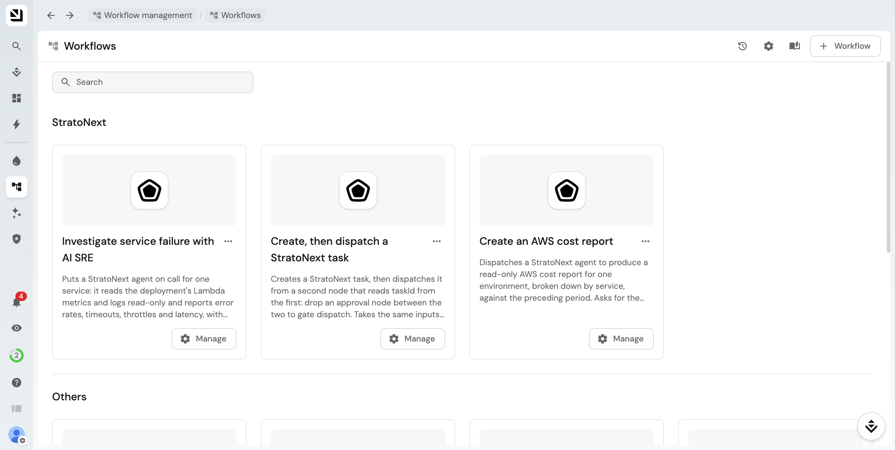

# StratoNext → Port

A [Port Ocean](https://github.com/port-labs/ocean) integration that keeps Port's software
catalog in sync with a StratoNext organization, and lets Port workflows put StratoNext
agents to work.

- **Export**: every workspace that enabled the Port integration, and per workspace the
  environments, agents, projects, tasks, scheduled jobs and reports, upserted as Port
  entities on a schedule. One container covers the whole organization.
- **Dispatch**: a self-service form in Port creates, dispatches or cancels a StratoNext
  task, so a button in Port turns into an agent doing real work.



Developers: see [CONTRIBUTING.md](CONTRIBUTING.md) for running from source, tests, and how
the pieces fit.

## Setup

Three places to touch, in this order: Port, StratoNext, then the container. Ten minutes.

### 1. Register the connector in Port

1. In the Port app go to **Context Lake → Connectors → New connectors** and pick
   **Custom Ocean integration**.
2. Choose the **Self-hosted** install. Port shows a `docker run` / `helm` command with your
   organization's credentials filled in. Copy three values out of it, nothing else:
   - `OCEAN__PORT__CLIENT_ID`
   - `OCEAN__PORT__CLIENT_SECRET`
   - `OCEAN__PORT__BASE_URL` (`https://api.port.io` for EU, `https://api.us.port.io` for US)

   Do not run the command as shown: it pulls Port's generic no-code image. This
   integration ships its own image (step 3) and registers itself on first run under the
   identifier **`stratonext`**. Keep that name: the connector, its data mapping and the
   `create_task` / `dispatch_task` / `cancel_task` actions are all registered under it, and
   the workflows and `push_mapping.py` target it. Another name creates a second, empty
   connector in Port. The same credentials are also under **Settings → Credentials**.

That is all Port needs for the export. Blueprints and the data mapping are created by the
container on its first run.

### 2. Enable the integration in StratoNext

Port is enabled once for the organization and switched on per workspace. The container syncs
exactly the workspaces where Port is switched on: the app identity can see a workspace only
while Port is enabled there.

1. An organization admin opens **Admin → Apps** and switches **Port** on. The first enable
   generates Port's credential and shows it **once**: a client ID and a client secret. Copy
   both into `.env` (step 3) before closing the dialog. A lost secret cannot be recovered,
   only rotated from the same page. The token URL is the StratoNext API origin plus
   `/oauth2/agent-token`.
2. A workspace admin switches **Port** on under the workspace's **Settings → Apps**.

Nothing is visible to Port until at least one workspace has it on. A workspace switched on
later is picked up on the next resync (every 60 minutes by default) or on restart. Switching
Port off in a workspace removes that workspace's entities from Port on the next resync;
switching it off for the organization stops the integration everywhere. The container logs,
at startup, which workspaces it can see.

### 3. Run the container

```bash
cp .env.example .env     # fill it in, see below
finch compose up --build
```

Or without compose:

```bash
finch build -t stratonext-port .
finch run --rm --env-file .env -p 8000:8000 stratonext-port
```

(`docker` works the same way if that is what you have.) The container listens on `:8000`,
resyncs the catalog on a schedule, and serves the dispatch endpoints. This is enough for
the export; see [Going live](#6-going-live) for the webhook dispatch.

Everything is set in `.env`. Required:

| Variable | What |
|---|---|
| `OCEAN__PORT__CLIENT_ID` / `OCEAN__PORT__CLIENT_SECRET` | From step 1 |
| `OCEAN__PORT__BASE_URL` | From step 1: `https://api.port.io` (EU) or `https://api.us.port.io` (US) |
| `OCEAN__INTEGRATION__CONFIG__STRATONEXT_API_URL` | StratoNext GraphQL endpoint, e.g. `https://api.prod.stratonext.com/v1/graphql` |
| `OCEAN__INTEGRATION__CONFIG__STRATONEXT_AUTH_TOKEN_URL` | Token URL from step 2, e.g. `https://api.prod.stratonext.com/oauth2/agent-token` |
| `OCEAN__INTEGRATION__CONFIG__STRATONEXT_AUTH_CLIENT_ID` | Client ID shown when Port was enabled (step 2) |
| `OCEAN__INTEGRATION__CONFIG__STRATONEXT_AUTH_CLIENT_SECRET` | Client secret shown when Port was enabled (step 2) |
| `OCEAN__INTEGRATION__CONFIG__PORT_WEBHOOK_SECRET` | A secret **you choose** (e.g. `openssl rand -hex 32`): nobody issues it. The container checks it on every webhook dispatch call, and you paste the same value into Port in step 5. **Unset, every webhook request is refused.** Not needed for the native actions. |

Optional:

| Variable | Default | What |
|---|---|---|
| `OCEAN__SCHEDULED_RESYNC_INTERVAL` | `60` | Minutes between full catalog resyncs. |
| `OCEAN__INTEGRATION__IDENTIFIER` | `stratonext` | Name of the connector in Port. **Leave it as `stratonext`** (see step 1). |

### 4. Check it worked

- **Context Lake → Connectors** lists `stratonext` with its sync status and event log. The
  first resync runs at startup; wait for it to complete.
- **Catalog** shows the seven blueprints below, with one `stratonextWorkspace` entity per
  enabled workspace. An empty catalog with a healthy connector means no workspace has
  enabled Port yet: the container log says so at startup.
- The data mapping is editable on the connector's page in Port. Port owns it from then on;
  the YAML in this repo only seeds the first run.
- **Connector present but no blueprints**, and the Port log reports failed entities: the
  first run was interrupted after it registered the connector (a network timeout does it).
  Ocean creates blueprints only together with the connector, so a restart will not add them.
  Delete the connector under **Context Lake → Connectors**, restart the container, and it
  creates everything again. If that first resync then logs `Integration not found` from
  Port's ingest host, Port's ingest side has not caught up with the recreated connector
  yet: trigger a resync from the connector's page a few minutes later.

### 5. Dispatch tasks from Port (optional)

Needed only for the self-service forms. The export works without it. Pick one of the two
paths in [Dispatching tasks from Port](#dispatching-tasks-from-port). For the webhook
fallback:

1. Pick a secret yourself, any long random string, and set it as
   `OCEAN__INTEGRATION__CONFIG__PORT_WEBHOOK_SECRET` in `.env`. Neither Port nor StratoNext
   generates it: it is a value only you and the container know, and Port sends it back on
   every dispatch call so the container can tell your workflows from anyone else on the
   internet.
2. In Port, under **Settings → Secrets**, add two secrets:
   - `STRATONEXT_INTEGRATION_URL`: the container's public base URL, no trailing slash
   - `STRATONEXT_WEBHOOK_SECRET`: the exact same value you put in `.env`
3. Import the workflows from `port-workflows.json`: paste each one into Port's workflow
   JSON editor, or POST it to `/v1/workflows`.

After the first resync the Project, Agent and Environment inputs on the forms become
dropdowns of real StratoNext resources.

### 6. Going live

A laptop is fine for the first sync. For real use the container needs to run all the time
and, for the webhook dispatch, be reachable from Port:

- **Host it as a long-running service** (ECS, Kubernetes, a VM): one replica, the same
  `.env` values as secrets, port `8000` exposed. Keep `OCEAN__INTEGRATION__IDENTIFIER`
  at `stratonext`: a redeploy under the same name picks up the existing connector, mapping
  and blueprints in Port; a new name starts a second connector from scratch.
- **Give it a public HTTPS address.** Port calls `/integration/tasks/*` on it for the
  webhook workflows, so put the container behind your usual ingress or load balancer and
  set that URL as `STRATONEXT_INTEGRATION_URL` in Port (step 5). On a laptop,
  `ngrok http 8000` does for a demo. The export itself never needs inbound access: the
  container only calls out to Port and StratoNext.
- **Set `PORT_WEBHOOK_SECRET`** before exposing it. Without it every dispatch request is
  refused, which is the safe default, but also means the forms do nothing.

## What you get in the catalog

| Blueprint | Relations | What it is |
|---|---|---|
| `stratonextWorkspace` | none | A workspace in the organization. Everything below belongs to one. |
| `stratonextEnvironment` | workspace | A cloud account/region an agent can operate in |
| `stratonextAgent` | workspace, environment | An AI operator registered in the workspace |
| `stratonextProject` | workspace | A unit of work agents and humans collaborate on |
| `stratonextTask` | workspace, project, agent | A unit of work assigned to an agent or a human |
| `stratonextScheduledJob` | workspace, project, agent | A recurring task an agent runs on a cron schedule |
| `stratonextReport` | workspace, projects | An incident, investigation or write-up against one or more projects |

Tasks dispatched from Port appear in the catalog on the next resync.

## Dispatching tasks from Port

There are two ways, with the same three operations behind them.

**Native actions.** The integration declares `create_task`, `dispatch_task` and
`cancel_task` as Port actions. A workflow node of type integration action calls them
directly, Port authenticates the run itself, and no secrets or workflow import are needed.
This is the path once the integration is installed from Port's catalog. Until Port lists
it, Port rejects `stratonext` as an integration provider, which is why the fallback exists.

**Webhook fallback.** `port-workflows.json` ships three ready-to-use workflows whose nodes
call the integration's `/integration/tasks/*` endpoints with the shared secret from
`PORT_WEBHOOK_SECRET`. Set it up as described in step 5 of [Setup](#setup).

General purpose:

| Workflow | What |
|---|---|
| `stratonext_create_then_dispatch` | Create a task, then dispatch it, in two steps so an approval node can gate the dispatch. Asks for name, description, optional instructions, workspace, project and agent. The workspace is optional when a project is chosen. |
| `stratonext_cancel_task` | Cancel a queued or running task. |

Showcase, where the task content is fixed and the form only exposes a few knobs:

| Workflow | What |
|---|---|
| `stratonext_aws_cost_report` | Read-only AWS cost report for one environment, broken down by service and compared against the preceding period. Inputs: environment, lookback days, granularity, agent. |

All dispatches are fire-and-forget: the workflow completes as soon as StratoNext accepts
the task, not when the agent finishes. Follow progress on the task in StratoNext or, after
the next resync, in Port.

### Targeting an environment

Which field a workflow sends decides what AWS access the agent gets:

- **Environment**: targets an environment directly. Use when the work isn't tied to a
  project.
- **Deployment**: preferred for project work. The agent resolves the environment plus the
  stack, region and resource graph from the deployment.

## Not included

Waiting for a dispatched task to finish, project→environment links within StratoNext, and
deployments as entities.

---

Licensed under the MIT License, see [LICENSE](LICENSE).
